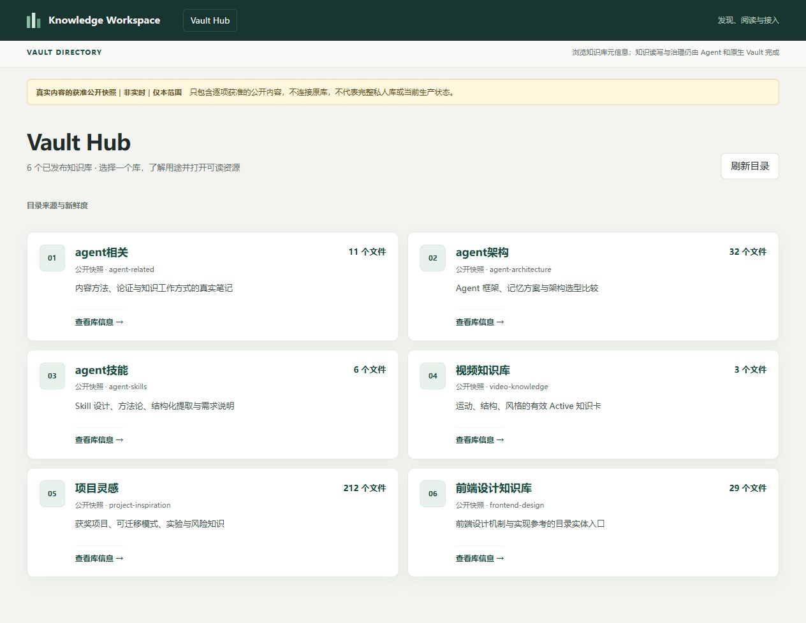
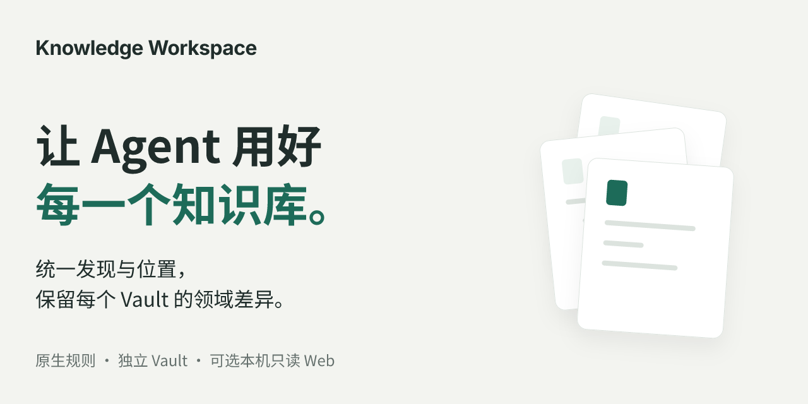
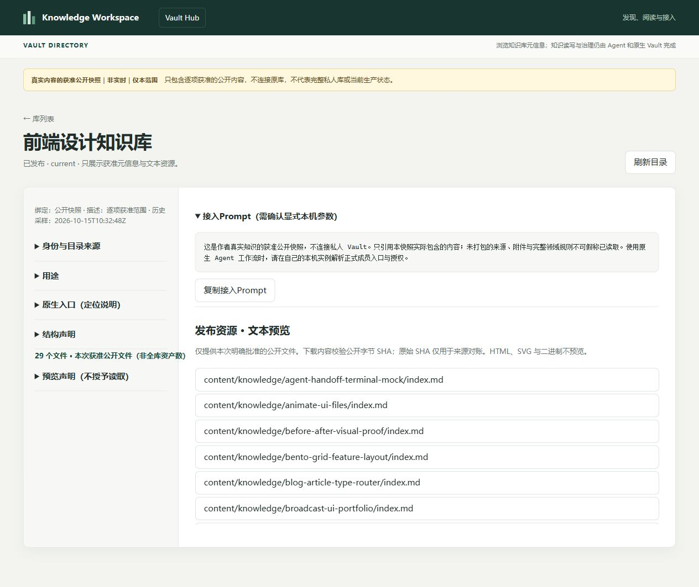
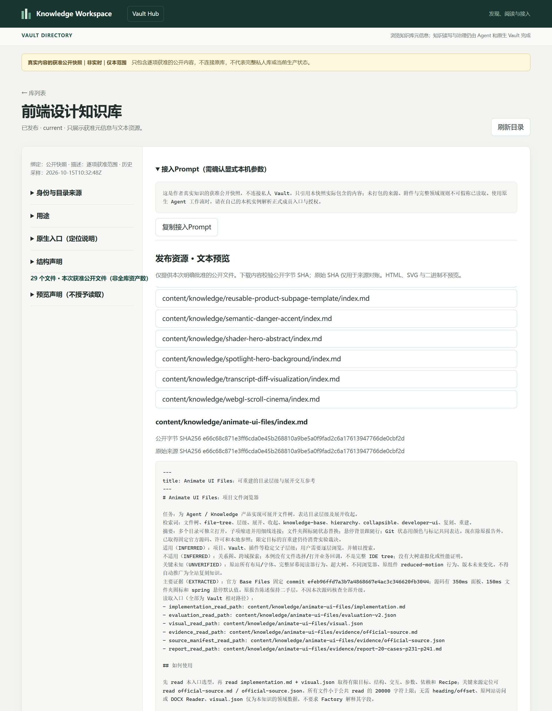
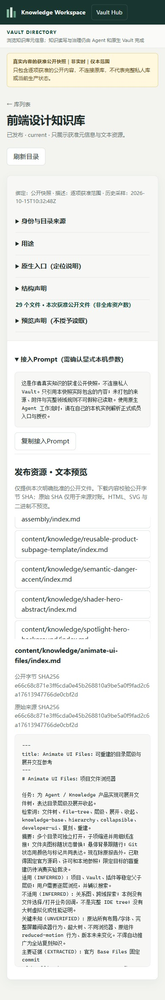

<h1 align="center">Knowledge Workspace · 知识库系统</h1>

<p align="center">让 Agent 按原生规则使用和建设多个独立知识库。</p>

适合用 Obsidian 积累研究、Skill、项目和媒体知识的开发者：保留每个 Vault 的结构、工具与发布规则，给 Agent 一个可核验的共同入口，再用可选的本机只读 Web 浏览、搜索和回看证据。

当前 Public Preview 提供一份经拥有者批准的**真实六库公开快照**：293 篇知识预览，保留各领域的目录、知识类型与来源说明。打开目录、选择知识条目，即可阅读文本并查看 Vault 相对位置、原文件 SHA-256 和公开预览 SHA-256。

[在线浏览真实六库公开快照](https://shltbro.github.io/knowledge-workspace/real-vaults/)



公开快照随本次源码提供，不连接作者私库，也不会追踪之后的更新或撤权。本机私人 Web 另有身份、绑定、原生可见性和精确授权检查。下文分别说明两种使用范围。

## 目录

[怎样工作](#怎样工作) · [能用来做什么](#能用来做什么) · [实际界面](#实际界面) · [安装与第一次使用](#安装与第一次使用) · [真实知识库如何使用](#真实知识库如何使用) · [架构与技术](#架构与技术) · [恢复与限制](#恢复与限制)

## 怎样工作

Agent 接到任务后，先通过 ENTRY 核对框架来源，再解析成员身份与当前位置，完整读取目标 Vault 的规则和索引，最后按它自己的 Workflow 使用知识、调用工具或完成写入。建新库时，**由外部 Agent 设计领域结构**，安全 Builder 根据经过确认的文件计划落盘；成功创建文件不等于领域任务已经通过。

可选的本机 Web 提供另一条阅读路径：当前位置、原生可见性、逐文件授权与 SHA 都满足后，才能返回目录、搜索结果和正文。它没有写入或授予读取权限的 HTTP 接口。


文件变化、撤权或绑定失效时，旧结果不能继续被当作当前可读知识。索引与文件需要在本机逐项复核；授权仍然不成立就保持拒绝，而不是自动放宽。

完整流程保留正常阅读、拒绝、复核和重试的全部连接。可选交互视图：[阅读与恢复](assets/diagrams/reading-complete.html)；[可编辑源](assets/diagrams/reading-complete.json)；[完整 SVG](assets/diagrams/reading-complete.svg)。另附局部放大视图：[正常阅读](assets/diagrams/reading-normal.html)、[失败恢复](assets/diagrams/reading-recovery.html)。交互 HTML 需本地 HTTP 打开，GitHub README 内展示静态图。

## 能用来做什么

| 你要完成的事 | 系统如何帮助 | 当前边界 |
|---|---|---|
| 让 Agent 使用已有知识 | 稳定成员 ID、唯一别名和本机位置绑定，指向完整的领域规则、索引与证据 | 不把所有库改成同一 Schema；不替代原领域质量门 |
| 创建不同领域的新 Vault | 外部 Agent 提出目录、类型与文件计划；Builder 校验 hash、暂存验证、禁止覆盖，再登记与收尾 | 需要实际可用的 Agent 宿主和明确写入授权；没有内置模型替你自动设计 |
| 浏览已公开的真实知识 | 公开快照按库列出条目，点击阅读文本，并显示相对路径和原文件/预览双 SHA | 本次293篇获准预览；无生产检索、写入或实时权限服务 |
| 在本机日常查找和回看知识 | 私人 Web 按库列目录、分页、关键词检索、受控 Markdown 阅读与 Obsidian 内链导航 | 需自己配置实例和授权；正文有字符预算，不替代 Obsidian 全部原生能力 |
| 按需使用成熟工具 | 共享 CLI / Skill 与固定输入安装器，支持 Repo、文章、Skill 和视频等工作流接线 | 各族成熟度不同；完整六族首装尚未就绪，第三方制品不随本候选分发 |
| 知识更新后安全地继续阅读 | 请求时重新发现，手动刷新；新路径和新 SHA 经过本机逐文件确认后再搜读 | 无后台自动授权；目录存在不代表获准阅读 |

这套方式适合已有独立治理的多个知识库。若只需要打开一个文件夹，直接使用 Obsidian 即可；若希望把所有领域统一成一个中央写入系统，本项目也不提供这种模型。



上图是产品结构的说明性设计图，页面功能以真实截图和可运行入口为准。

## 实际界面

首页先列各库用途，再进入真实知识目录。本次公开范围如下；数字只指本次公开预览，不能当作原库全部内容数量。

| Vault | 公开预览 | 内容形态 |
|---|---:|---|
| ① Agent 相关 | 11 | 内容方法与模式笔记 |
| ② Agent 架构 | 32 | 架构比较、框架画像与决策规则 |
| ③ Agent 技能 | 6 | Skill 设计、需求与方法归纳 |
| ④ 视频知识 | 3 | 结构、动效和风格的领域 JSON 卡 |
| ⑤ 项目灵感 | 212 | 项目、机制、实验和风险卡 |
| ⑥ 前端设计 | 29 | `content/knowledge` 目录实体的入口笔记 |

**理解一个库，再进入内容。** 详情保留领域用途和接入说明。公开页说明的读取对象是随包快照；它不能授予访问原私库的权限。



**从目录读到原生知识。** 阅读区显示真实文本、来源信息和相对路径。双 SHA 分别标识原文件与本次公开字节。其中25份仅隐藏了本机路径，因此以公开预览 SHA 标识修改后的字节，不能冒称原件。293份均未截断。





附件和证据中的相对指针可以帮助理解来源，但未随本次公开范围携带的原工件、媒体、完整转写和 pinned source 不会因出现链接而自动公开。快照提供目录与文本浏览，不提供生产搜索、Writer 或私人权限变更。

开发样例的历史界面另存：[Sample 总览](assets/screenshots/hub-desktop.jpg)、[Sample 详情](assets/screenshots/detail-prompt-desktop.jpg)、[Sample 阅读](assets/screenshots/reader-desktop.jpg)、[Sample 窄屏](assets/screenshots/reader-mobile.jpg)。这些使用虚构数据，不作为上述真实知识的证据。

## 安装与第一次使用

### Quick Start：先打开真实公开快照

在源码目录根运行以下命令。只需 Python 标准库，不需要模型、私人令牌、Obsidian 或 npm。

```powershell
python --version
python -m http.server 8000 --bind 127.0.0.1 --directory docs
```

打开 [http://127.0.0.1:8000/real-vaults/](http://127.0.0.1:8000/real-vaults/)。选择一个 Vault，在目录中点击知识条目，查看正文、相对路径和两份 SHA-256。首页应显示六库、本次293篇公开预览。按 `Ctrl+C` 停止服务。

服务只读取 `docs/real-vaults/` 中已经批准的静态文件，不发现读者自己的本机 Vault，不需要初始化 Registry。它使用相对资源路径，可放在静态站点的子路径下。与之独立的 `docs/demo/` 仍保留虚构 Sample Data，供开发和测试使用，不代表本页的真实内容。

### 安装源码环境与运行隔离测试

框架要求 Python 3.11+。本次实际验证平台为 **Windows x64 / CPython 3.14**；其他平台和 Python 版本尚未在本轮验证。部分安全写入和进程管理依赖 Windows。

在项目根目录执行：

```powershell
python -m venv .venv
.\.venv\Scripts\python.exe -m pip install -r requirements.txt
.\.venv\Scripts\python.exe -m pip install -r requirements-dev.txt
.\.venv\Scripts\python.exe -m pip install --no-build-isolation -e .
.\.venv\Scripts\python.exe -m pytest -q
```

本候选携带可独立运行的隔离测试，不要求作者的私人六库或真实令牌；覆盖成员/位置、安全落盘与收尾、原生只读浏览及生命周期行为。源码环境已在全新虚拟环境用逐包校验的离线依赖验证；在线 PyPI 安装因本机网络不可用未获验证。离线依赖只用于本地验证，未随源码候选捆绑。不要将此命令扩大理解为所有领域和全部工具已经验收。

开发时需要重新生成虚构样例，可在安装源码依赖后选择一个**尚不存在**且父目录存在的输出位置；此命令不会生成或更新真实公开快照：

```powershell
python tools/kb_display_public_sample.py --output docs/demo-new
python -m http.server 8001 --bind 127.0.0.1 --directory docs
```

打开 [http://127.0.0.1:8001/demo-new/](http://127.0.0.1:8001/demo-new/)。构建器会拒绝覆盖已有目录，并生成逐文件完整性清单。

## 真实知识库如何使用

本机私人 Web 与公开快照使用独立入口。本候选没有携带作者的私人实例、成员绑定、授权文件或令牌，也没有通用的首次私人配置向导。上述静态服务命令不会连接你的 Obsidian，公开内容不构成生产实例。

接入真实库需要：共同成员来源、当前机器的精确位置绑定、该库原生目录规则、经拥有者批准的精确文件范围，以及本机访问令牌。主系统统一身份和接入方式；各库继续决定什么知识有效、怎么发布和如何写入。未知领域规则不会被默认放行。

已配置的 Windows 实例可使用现有入口：

```powershell
.\scripts\KnowledgeWorkspace.ps1 -Action start
.\scripts\KnowledgeWorkspace.ps1 -Action status
# 仅当文件内容/原生索引已变且有权审核时，逐项确认：
.\scripts\KnowledgeWorkspace.ps1 -Action review -VaultId your-vault-id
.\scripts\KnowledgeWorkspace.ps1 -Action stop
```

该包装入口读取 `%LOCALAPPDATA%\KnowledgeWorkspace\local-web.json` 的路径引用及既有配置；首次使用可能安装旧 Reader 兼容依赖，不是前述最小测试环境的零配置启动器。只监听 `127.0.0.1`，停止时核验进程身份。开发调用可从 `python tools/kb_display_local.py --help` 查看显式输入。

浏览器连接使用本机私有文件中的令牌，只保存在当前标签页 `sessionStorage`，不放 URL。文件内容变化时，旧 SHA 的授权不能读取新正文；新文件也必须经本机 CLI 逐项确认。Web 无法替你授权。原生 Writer、索引、事务和发布收尾继续在各自 Vault 中完成。

让 Agent 开始真实任务时，明确提供框架入口、实例、目标成员及获准读写范围，然后要求它读取完整原生规则、实际执行并给出来源和检查结果。[ENTRY.md](ENTRY.md) 是本导出的使用边界说明；正式来源闭包还依赖原框架的 STATE/INVARIANTS/依赖控制文件，本候选未打包该完整闭包，因此不能承诺下载后直接通过正式 ENTRY 来源门。

## 架构与技术

**系统边界**：Agent 是任务执行者，独立 Vault 保留领域权威；本机 Web 是可选阅读端。真实公开快照只携带本次获准字节，Sample Demo 只携带虚构数据，两者均不连接私人实例。


**内部职责**：ENTRY、成员/位置解析和安全操作是本地 Python 模块与 CLI，不是微服务集群。STATE 和展示投影是衍生状态，不能成为第二成员或知识权威。


可选交互：[Context](assets/diagrams/c4-context.html)、[Containers](assets/diagrams/c4-containers.html)；源数据：[Context](assets/diagrams/c4-context.json)、[Containers](assets/diagrams/c4-containers.json)。

| 技术 | 实际职责 |
|---|---|
| Python 标准库 | 本地 CLI、文件/哈希检查、环回 HTTP、进程与恢复管理；公开静态预览无需第三方运行库 |
| Pydantic / PyYAML | 验证框架结构契约、读取领域描述和 YAML 信息；不规定所有领域的内部 Schema |
| JSON 成员与机器绑定 | 稳定身份和本机当前位置分离；不会通过扫盘或旧 SQLite Registry 猜测位置 |
| Markdown / JSON / 目录实体 | 由领域选择知识组织方式；原文件继续是知识来源 |
| HTML / CSS / 原生 JavaScript | 只读展示、Prompt、受控文本阅读；私人浏览与公开静态数据入口分离 |
| 复用 Reader / BM25 能力 | 安全路径读取和关键词匹配；不把索引变成真相源，不承诺语义检索 |
| 本地第三方 CLI / Skill | 由原生 Workflow 按需调用；固定制品、许可和安装条件独立核验，不由网页执行 |

与统一导入平台相比，这里尽量保留已有 Vault 的能力：共同层负责找到正确的库、核验来源与位置、保护操作边界；领域语义、质量规则和最终任务验收留在领域里。Web 只暴露经明确接线的阅读能力，不能宣称它发挥了 Obsidian 及各库的全部原生能力。

## 恢复与限制

| 看到的情况 | 如何处理 |
|---|---|
| 公开页面 404 | 确认在源码根启动、地址以 `/real-vaults/` 结尾；不要直接双击 HTML 的 `file://` 路径 |
| 公开快照与后来原库内容不同 | 快照固定在本次公开范围；它不追踪原库更新和撤权，需要重新审阅后发布新快照 |
| 端口占用 | 改用空闲端口，或检查自己启动的服务；不终止身份不明的进程 |
| 私人 Web 认证失败 | 在本机核对私有令牌文件与轮换状态，在当前标签重新连接；不要贴到聊天或 URL |
| 内容变更或新路径不可读 | 先完成原生质量门，再运行本机逐文件 review；跳过或不批准就继续拒绝 |
| 成员离线、撤权或索引资格不符 | 修复当前绑定或原生发布状态后重试；缓存和旧快照不能授予权限 |
| 正式 ENTRY 或部署安装失败 | 当前导出未携带完整控制闭包及工具制品；不要通过删除来源检查或降低质量门绕过 |

文中“六族”指接入与建库、Skill 设计复用、Repo 蒸馏、文章与会话、视频素材蒸馏、视频知识使用，与本次六库内容数量无关。完整六族安装尚未就绪，现有 Node 安装代码仍有固定运行时路径，Python 安装器也要求特定 wheel 输入；模型、权重、第三方 Skill 与二进制不在本候选内。这里没有云同步、多人协作、中央领域执行器、自动生产迁移或后台自动授权。

**公开边界**：此目录是 Public Preview 源码候选，不是完整 v1.1 正式版。本次293篇真实预览已按具体文件和公开字节获得拥有者批准，范围不是全部320条原生目录项。自有代码采用 [MIT](LICENSE)；检索适配保留 [上游完整 MIT 许可](licenses/llm-wiki-kit-MIT.txt)。知识笔记中的来源与原权利继续保留，软件许可不授予第三方材料的新权利。第三方来源见 [版权说明](THIRD-PARTY-NOTICES.md)。
