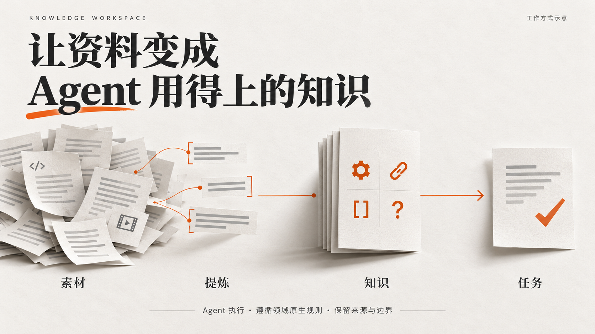
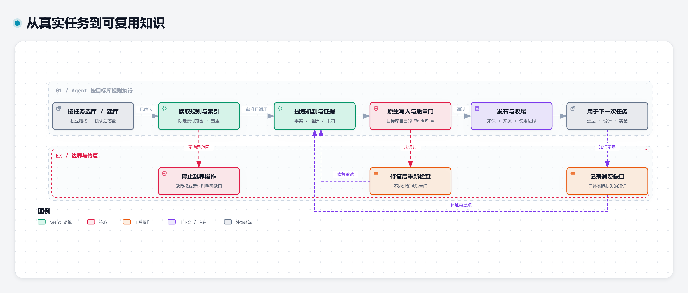
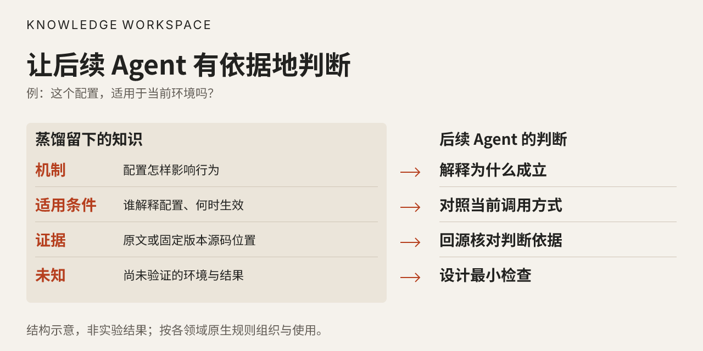
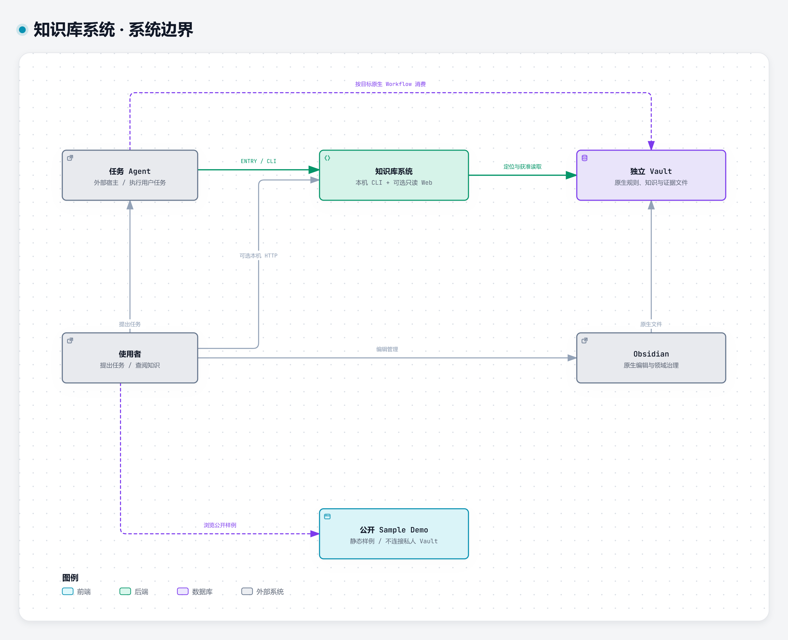
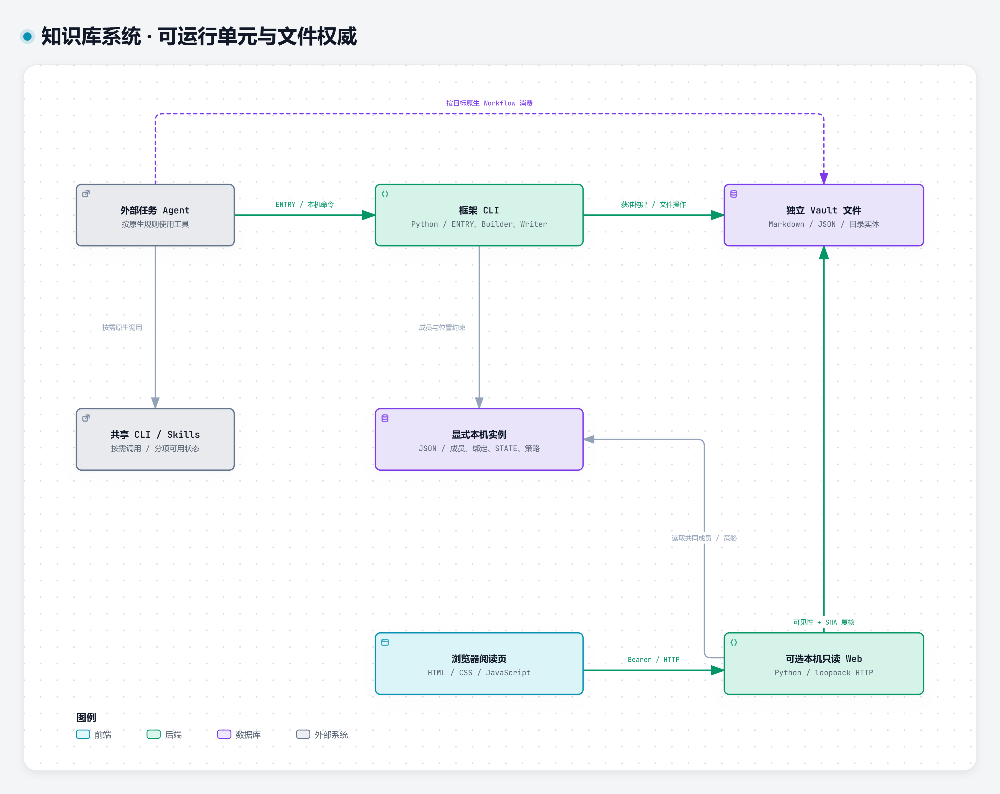
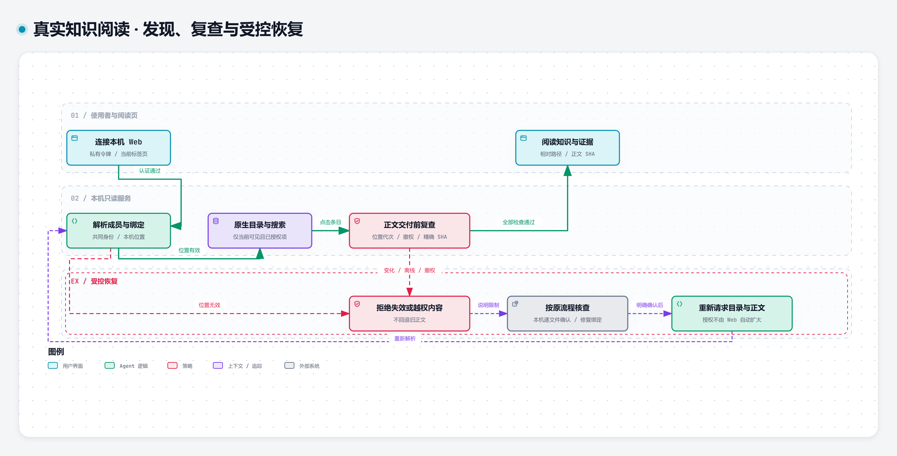

<h1 align="center">Knowledge Workspace · 知识库系统</h1>

<p align="center"><strong>让资料变成 Agent 用得上的知识。</strong></p>

给经常做研究、开发和设计的 Agent 建立长期可用的知识库：按任务设计领域规则，把文章、源码和视频里的方法与证据留下来，供后续选型、实现和实验使用。



*上图是工作方式示意，不是运行截图。蒸馏由外部 Agent 和各库原生工作流执行；不同材料链路的实际完成范围见下文。*

## 目录

[核心用途](#从建库到用知识) · [按任务建库](#按任务建库) · [知识蒸馏](#把资料蒸馏成知识) · [怎样使用知识](#蒸馏后用来做什么) · [已经跑通什么](#已经跑通什么) · [系统怎样配合](#系统怎样配合) · [开始使用](#开始使用) · [边界与恢复](#边界与恢复)

## 从建库到用知识

**给 Agent 一套建库和积累知识的方法，让每次研究能被下次任务用上。**

| 你要做什么 | 系统提供什么 | 最后得到什么 |
|---|---|---|
| 为一个新领域建库 | Agent 按任务设计类型、目录、证据与质量规则；确认后安全创建、登记 | 有自己规则的独立 Vault |
| 把资料变成知识 | 读取领域规则、查重，提炼机制与边界，保留来源，再走原生检查 | 可检索、可回源、可继续维护的知识 |
| 用积累完成任务 | Agent 找到目标库，按原生规则搜读知识与证据 | 有依据的选型、设计或实验方案 |



*Agent 与目标库的原生工作流完成这条链；框架提供位置、安全文件操作和收尾。质量检查失败就修复再验，不能跳过后继续发布。*

## 按任务建库

告诉 Agent：**这个库要帮谁，完成什么任务，怎样才算做对。** 它据此设计知识结构和规则，而不是从固定模板里选一个文件夹。

```text
提出需求 → Agent 设计 → 审阅文件计划 → 安全创建 → 登记接入 → 用真实任务验收
```

建库方案要交代四件事：

- **存什么：** 知识类型、粒度、目录与文件格式。
- **怎么用：** 用途说明、Agent 规则、索引与证据入口。
- **怎么维护：** 查重、写入、更新和原生质量检查。
- **怎么验收：** 最终消费者要完成什么任务，哪些结果算失败。

视频库可以用时间戳和镜头结构，源码库可以用固定版本与实现定位，研究库可以用项目、实验和风险。**统一身份、接入和安全操作，保留各领域自己的结构与规则。**

确认后的计划由 Builder 核对哈希，经暂存、校验再放置；不覆盖已有目录。登记与收尾分别记录系统、领域和展示结果：**创建成功，不等于知识质量合格。** 当前设计者是外部 Agent，框架不内置一个替所有领域做决定的中央 Designer。

## 把资料蒸馏成知识

**留下能复用的方法和证据，而不只留下“读过这篇文章”。**

```text
读领域规则 → 提取获准材料 → 查重与提炼 → 原生写入和检查 → 下次任务使用
```

一篇文章留下结论及适用条件；一段源码留下机制及版本定位；一个案例留下起作用的关系与未知。事实、推断、建议、未核验内容分开记录。检查失败就修复产物，证据不足就缩小结论。



*知识结构示意，不是统一 Schema 或实验结果。各库按任务决定实际字段与组织方式。*

可选：[查看完整流程](assets/diagrams/distillation.html) · [可编辑流程数据](assets/diagrams/distillation.json)

## 蒸馏后用来做什么

- **选方案：** 比较机制、约束和风险，说明为什么选它。
- **做实现：** 复用已核验的结构与实现线索，缺参数就明确补查。
- **做实验：** 把已知条件和失败记录带进计划，避免重复试错。

验收看后续任务能否完成、能否回到证据；搜到卡片和写入成功都不能代替它。当前已跑通与仍在施工的范围列在下面。

## 已经跑通什么

下面区分真实闭环与仍在施工的部分。仓库是 **Public Preview**，未承诺下载后自动蒸馏任意素材。

| 链路 | 已有真实运行结果 | 尚不能据此承诺 |
|---|---|---|
| 单篇文章入库 | 固定 HTML 经 Defuddle 提取，公共搜读查重，Writer 写入，原生 lint，重启后搜读与证据 SHA 对账 | 任意文章自动入库；独立第二消费者验证完成 |
| 有界源码消费 | 按授权文件与 SHA 校验范围，Repomix 打包，Agent 依据源码解释实现和失败条件 | Repo 到知识卡、索引和发布的完整自动闭环 |
| Skill 复用决策 | 真实文章任务选择复用 Defuddle，避免为已有动作重复造 Skill | 所有 Skill 的行为测试和完整安装已经就绪 |
| 视频素材处理 | 自创六秒素材完成切镜、OCR 与关键帧处理 | 任意视频都能自动形成高质量领域知识 |
| 原生知识消费与建库 | 已有代表性原生查询、差异化建库，以及限定前端知识消费实验 | 所有领域都已通过效果验收；完整生产迁移完成 |
| 本机只读 Web | 六库真实目录、搜索、分页、受控正文与证据阅读；内容变化后逐文件复核 | 网页取代原生 Agent、Writer 或 Obsidian 的全部能力 |

当前公开仓库携带框架源码、隔离测试和一份经批准的真实知识快照。私人领域工作流、实例配置、模型宿主和完整工具制品没有随包配齐。

## 系统怎样配合

**外部 Agent 执行任务。** ENTRY 与共同成员、位置绑定帮助它找到正确的库；Agent 读取原生规则，再按该库工作流消费或写入。

**独立 Vault 保存知识并掌握领域规则。** 可以采用 Markdown、JSON、目录实体或不同类型组合，不需要改成同一套内部结构。原生索引、质量门和发布流程继续有效。

**共享能力按需调用。** 文章提取、源码整理、Skill 与视频工具服务于任务；安装、许可和运行状态分别核验。

**Web 是可选阅读端。** 用于浏览、搜索和回看证据，没有写入或授予读取权限的 HTTP 接口。知识生产与领域执行不会被搬进网页。

外部 Agent、框架、原生 Vault 与可选只读 Web 的关系：



ENTRY、成员与位置解析、安全操作由本地 Python 模块与 CLI 完成，不是微服务集群。状态和展示投影不能成为第二成员或知识权威。



可编辑架构数据：[系统边界](assets/diagrams/c4-context.json)、[运行单元](assets/diagrams/c4-containers.json)。

<details>
<summary>可选：本机只读阅读与授权恢复</summary>

本机 Web 的读取需同时满足身份、位置、原生可见性、逐文件授权与 SHA；变化或撤权后重新核验，不能自动放宽。



可选交互视图：[系统边界](assets/diagrams/c4-context.html)、[模块关系](assets/diagrams/c4-containers.html)、[阅读与恢复](assets/diagrams/reading-complete.html)。交互 HTML 需用本地 HTTP 打开。


</details>

| 技术 | 职责 |
|---|---|
| Python / PowerShell | CLI、契约、文件与哈希检查、启动及恢复管理 |
| Pydantic / PyYAML | 结构验证、领域描述与 YAML 信息读取 |
| 成员与机器绑定 | 稳定身份和本机位置分离，不依靠扫盘或旧 Registry 猜测位置 |
| Reader / BM25 | 安全读取与关键词匹配，索引可重建且不授予权限 |
| HTML / CSS / JavaScript | 可选的只读展示与受控阅读 |
| 本地第三方 CLI / Skill | 由原生工作流按需调用，固定制品、许可和安装条件独立核验 |

## 开始使用

### 先看已有知识产物

下载本仓库源码并解压，终端进入含 `README.md` 的根目录。

[在线阅读获准公开的知识快照](https://shltbro.github.io/knowledge-workspace/real-vaults/)，或在源码根目录运行：

```powershell
python --version
python -m http.server 8000 --bind 127.0.0.1 --directory docs
```

打开 [http://127.0.0.1:8000/real-vaults/](http://127.0.0.1:8000/real-vaults/)，从目录进入知识正文；`Ctrl+C` 关闭。只需 Python 标准库，不需要模型、私人令牌、Obsidian 或 npm。

这是本次批准的293份真实知识预览，部分文件仅隐藏本机路径，未截断；页面显示原文件与公开字节的 SHA。它不连接原私库，不跟踪后续更新或撤权，不提供生产搜索或写入。未随包携带的证据工件不会因出现链接而公开。独立的 `docs/demo/` 使用虚构 Sample Data，仅供开发测试。

### 安装源码环境

要求 Python 3.11+；本次实际验证平台为 **Windows x64 / CPython 3.14**。其他平台和版本尚未在本轮验证，部分安全写入与进程管理依赖 Windows。

```powershell
python -m venv .venv
.\.venv\Scripts\python.exe -m pip install -r requirements.txt
.\.venv\Scripts\python.exe -m pip install -r requirements-dev.txt
.\.venv\Scripts\python.exe -m pip install --no-build-isolation -e .
.\.venv\Scripts\python.exe -m pytest -q
```

隔离测试不依赖作者的私人 Vault 或令牌，覆盖成员与位置、安全落盘与收尾、只读浏览及生命周期。源码环境已在新虚拟环境用逐包校验的离线依赖验证；在线 PyPI 安装因本机网络不可用未获验证。离线依赖未随包捆绑。

### 先试一次成员登记

安装后，在源码根运行：

```powershell
.\.venv\Scripts\python.exe examples/membership-first-use.py
```

它只在临时目录创建示例规则与索引，调用正式 CLI 登记并按别名解析，验证同一操作可幂等重放，最后自动清理。不会访问或改动你的 Obsidian 库。预期输出 `registered: sample-notes`、`binding: online`、`replayed: true`。这验证接入链，不代表蒸馏或领域质量已通过。

### 接入自己的知识库

为 Agent 提供框架入口、实例、目标成员及获准读写范围，要求它先读完整原生规则，再执行任务、引用来源并完成原生检查。已有 Vault 保留原位置和业务结构；新 Vault 由 Agent 设计，再经确认后的安全落盘流程创建。

**当前导出还不是零配置蒸馏安装包。** [ENTRY.md](ENTRY.md) 说明导出的使用边界；正式来源门还依赖原框架的 STATE、INVARIANTS 与依赖控制文件，本候选未打包完整控制闭包。私人实例、成员绑定、文件授权、模型宿主和领域工具也需单独配置，尚无通用首次配置向导。

具备上述配置后，可以用下面的任务模板开始。需替换实际入口、目标与获准材料；它是交给 Agent 的任务，不是可独立运行的安装命令。

```text
目标：让后续 Agent 能判断 [一个具体问题]，并回到证据。
框架与实例：[正式入口及已配置实例]
目标 Vault：[成员 ID]
材料与权限：[获准的单篇材料；允许读取及写入的精确范围]

先读取目标库原生规则与索引，检索是否已有相关知识。
提炼结论、机制、适用条件和未知，保留必要证据与原始定位。
按领域规则确定复用、补充或新增；仅在获准范围内执行写入与收尾。
交付实际产物路径、查重依据、原生质量检查结果和回源路径。
最后用 [具体问题] 重新检索并读取；未通过的检查或未验证的结论如实列出。
```

已经配置好的 Windows 实例可使用：

```powershell
.\scripts\KnowledgeWorkspace.ps1 -Action start
.\scripts\KnowledgeWorkspace.ps1 -Action status
# 文件或原生索引变更后，由有权审核者逐项确认：
.\scripts\KnowledgeWorkspace.ps1 -Action review -VaultId your-vault-id
.\scripts\KnowledgeWorkspace.ps1 -Action stop
```

入口读取 `%LOCALAPPDATA%\KnowledgeWorkspace\local-web.json` 中的路径引用及既有私有配置；首次可能安装旧 Reader 兼容依赖。只监听 `127.0.0.1`，停止时核验进程身份。显式开发参数见 `python tools/kb_display_local.py --help`。

## 边界与恢复

| 情况 | 处理方式 |
|---|---|
| 知识仍缺少完成任务的证据 | 记录缺口，补充获准调查或缩小结论；不能把推断写成核验事实 |
| 原生质量检查不通过 | 修复领域产物后复验，登记、网页和搜索命中都不能替代质量门 |
| 内容修改或出现新文件 | 原生收尾后，私人 Web 仍需按文件复核 SHA 与授权；不会自动批准新正文 |
| 认证失败、成员离线或撤权 | 在本机检查令牌、绑定或发布状态；旧快照和缓存不能授予权限 |
| 正式 ENTRY 或工具安装失败 | 核对缺失的控制闭包、制品和环境，不删除来源检查来绕过 |
| 静态预览 404 或端口占用 | 在源码根启动，确认 `/real-vaults/` 地址；换空闲端口，不终止身份不明的进程 |

私人 Web 的令牌只来自本机私有文件，浏览器只在当前标签页 `sessionStorage` 保存，不放 URL、聊天或 Git。公开快照与私人实例完全分离。

完整六族安装仍在推进：接入与建库、Skill 设计复用、Repo 蒸馏、文章与会话、视频素材蒸馏、视频知识使用。Node 安装代码仍有固定运行时路径，Python 安装器需要特定 wheel 输入；模型、权重、第三方 Skill 和二进制未随本候选分发。没有云同步、多人协作、中央领域执行器、自动生产迁移或后台自动授权。

自有代码采用 [MIT](LICENSE)；检索适配保留 [上游完整 MIT 许可](licenses/llm-wiki-kit-MIT.txt)。知识笔记中的来源与原权利继续保留，软件许可不授予第三方材料的新权利，详见 [版权说明](THIRD-PARTY-NOTICES.md)。当前为 Public Preview，完整 v1.1 正式版仍有安装、生产接替与恢复条件待完成。
