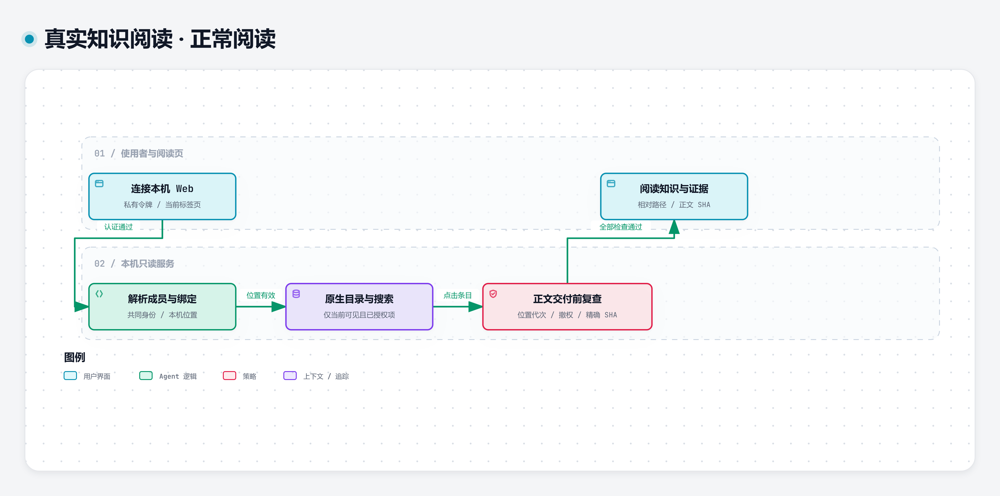
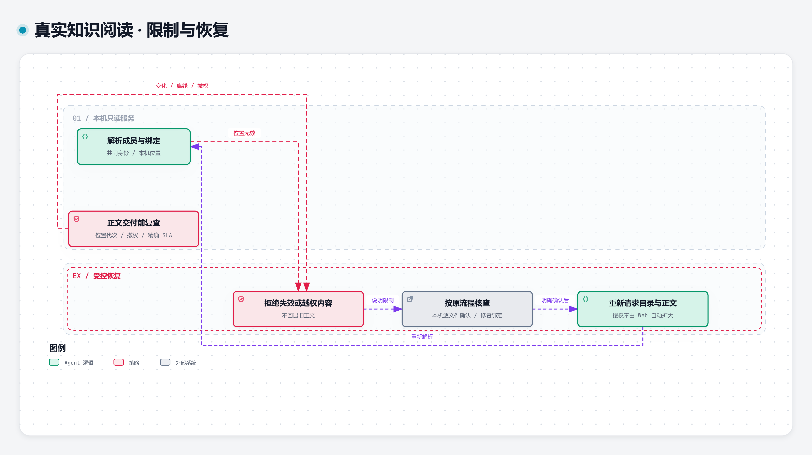

# 本机阅读与受控恢复

## 正常阅读

本机连接成功后，服务从共同成员和绑定读取当前位置，按原生索引与可见性列出获准条目。点击正文时再次检查原生资格、精确授权 SHA、绑定代次与撤权状态，随后交付有界正文、相对路径及 SHA。

[交互图下载](reading-normal.html) · [可编辑 JSON](reading-normal.json) · [SVG](reading-normal.svg)

## 限制与恢复

位置无效、文件变化、离线、撤权均可拒绝读取。使用者按本机逐文件确认流程或原生规则核查，再重新发起目录与正文请求。Web 不自动扩大新文件权限，也不将失效旧正文显示为当前内容。

[交互图下载](reading-recovery.html) · [可编辑 JSON](reading-recovery.json) · [SVG](reading-recovery.svg)

| 关系 | 条件／含义 | 源码证据 |
| --- | --- | --- |
| 连接 → 成员位置 | Bearer 认证通过 | local_vault_web.py:1425、1521 |
| 成员位置 → 目录搜索 | 当前绑定有效 | local_vault_web.py:365、852、1129 |
| 目录搜索 → 正文复查 | 点击具体条目 | local_vault_web.py:725 |
| 正文复查 → 阅读 | 原生资格、授权、代次、SHA 全部通过 | local_vault_web.py:725、617 |
| 正文复查 → 拒绝 | 变化、离线、撤权 | local_vault_web.py:725、617 |
| 成员位置 → 拒绝 | 位置无效 | local_vault_web.py:365 |
| 拒绝 → 核查 | 明确限制原因 | local_vault_web.py:53、tools/kb_display_local.py |
| 核查 → 重新请求 | 明确确认后 | local_vault_web.py:1227、1264 |
| 重新请求 → 成员位置 | 重新解析；不沿用失效结果 | local_vault_web.py:365、617 |

两张视图共同保留完整原流程的 8 个节点与 9 条有向关系。交互 HTML 是可下载本地文件，目前没有远程托管地址。图表描述实现逻辑，不证明未知 Vault 的所有语义已自动适配。
